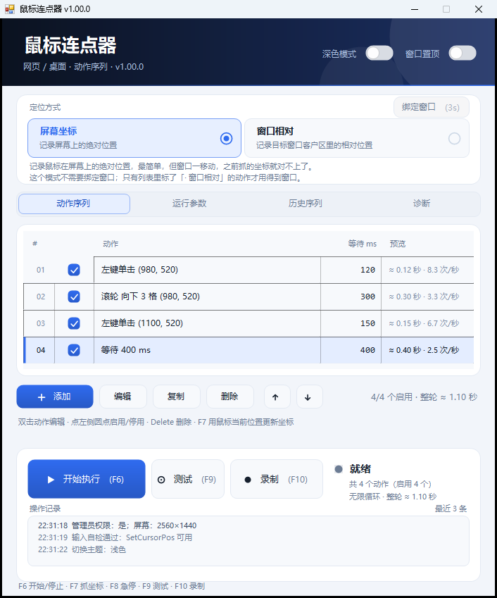

# 鼠标连点器

[](https://github.com/dengsy1993/AutoClicker/releases/latest)
[](https://github.com/dengsy1993/AutoClicker/releases)
[](https://github.com/dengsy1993/AutoClicker/actions/workflows/build.yml)
[](#)
[](LICENSE.txt)

Windows 上的自动点击工具：按你排好的步骤，自动移动鼠标、点击、滚动、按键。
网页游戏挂机、重复点按钮、批量填表这类「手不能停」的活儿都适合。

| 深色 | 浅色 |
| --- | --- |
|  |  |

- **单文件 exe**，绿色免安装，不需要 Python / Java / .NET SDK
- **四种动作**：鼠标点击、鼠标滚轮、键盘按键、等待
- **全局快捷键**、**录制回放**、**历史序列**、**输入自检**
- **配置跟着程序走**：整个文件夹拷到别的电脑就能继续用

> **下载**：[最新版](../../releases/latest)　·　**macOS 版**：[说明](macos/README.md)　·　**遇到问题**：[提 Issue](../../issues)

---

## 1. 三十秒开始用

1. 下载 `AutoClicker_v1.00.0.zip`，解压到**桌面**或 `D:\Tools` 这类普通目录
2. 双击 `AutoClicker.exe`
3. 把鼠标移到要点击的位置，**选中列表里的那条动作**，按 <kbd>F7</kbd>
   （F7 = 把当前鼠标位置写进选中的动作）
4. 按 <kbd>F6</kbd> 开始，再按一次 <kbd>F6</kbd> 停止

任何时候按 <kbd>F8</kbd> 都能**急停**。到这一步，最常见的用法就能跑了。

---

## 2. 界面上一共就四块

```
┌──────────────────────────────────────────────┐
│ 定位方式        屏幕坐标 / 窗口相对           │  ← 坐标怎么记
├──────────────────────────────────────────────┤
│ 动作序列 │ 运行参数 │ 历史序列 │ 诊断        │  ← 四个页签
├──────────────────────────────────────────────┤
│              当前页签的内容                   │
├──────────────────────────────────────────────┤
│ 开始执行(F6)  测试(F9)  录制(F10)   状态     │  ← 运行控制
│ 操作记录（最近几条日志）                      │
└──────────────────────────────────────────────┘
F6 开始/停止 · F7 抓坐标 · F8 急停 · F9 测试 · F10 录制
```

| 页签 | 干什么 |
| --- | --- |
| **动作序列** | 排你要执行的步骤，主界面 |
| **运行参数** | 循环次数、延迟、抖动、点击方式 |
| **历史序列** | 把整套动作存起来，以后一键载入 |
| **诊断** | 点不动的时候来这儿查原因 |

---

## 3. 定位方式：屏幕坐标 还是 窗口相对

顶部两张卡，二选一；选中哪张，下面那行说明就跟着变。

### 屏幕坐标（默认，建议先用这个）

记录鼠标在屏幕上的**绝对位置**。简单直接，缺点是**窗口一移动，之前抓的坐标就对不上了**。

适合：最大化的网页游戏、位置固定的按钮。

### 窗口相对

记录**目标窗口客户区里的相对位置**，执行时按窗口当前位置实时换算。
窗口拖动、缩小、重新打开，动作还能点对地方。

用法：

1. 点「窗口相对」这张卡
2. 点右上角的「**绑定窗口**」
3. **3 秒内**切换到目标窗口，3 秒后自动完成绑定
4. 绑定成功会显示「已绑定：窗口标题」，之后新加的动作都按窗口坐标记

> 绑定后如果列表里正好有动作落在该窗口内，程序会问你要不要**一起转成窗口坐标**，
> 点「是」就批量转换，省得一个个重新抓。
>
> 切回「屏幕坐标」时，绑定按钮会变灰——屏幕坐标本来就不需要窗口，这是正常的。

---

## 4. 四种动作

点「**＋ 添加**」选类型，或者录制时自动生成。

| 类型 | 要填什么 | 说明 |
| --- | --- | --- |
| **鼠标点击** | 左/右/中键、单击或双击、X/Y、等待 | 最常用 |
| **鼠标滚轮** | 向上/向下、格数、X/Y、等待 | 会先移到坐标再滚 |
| **键盘按键** | 点输入框后**按下你要按的键**（可带 Ctrl/Alt/Shift）、等待 | 不能只按修饰键 |
| **等待** | 毫秒数 | 不产生输入，只控制节奏 |

几个细节：

- 每种动作都有「**动作后等待**」，即做完这步停多久再做下一步。
  输入框下面会实时显示「≈ 0.12 秒 · 8.3 次/秒」，方便估算速度。
- 坐标可以直接填，也可以按 <kbd>F7</kbd> 抓当前鼠标位置。
- 每条动作都能单独**启用 / 停用**（点最左边的圆点），调流程时不用删掉。

---

## 5. 列表里的操作

| 操作 | 效果 |
| --- | --- |
| 单击某行 | 选中 |
| **双击** | 编辑这条动作 |
| <kbd>Delete</kbd> | 删除选中 |
| <kbd>Ctrl</kbd>+<kbd>D</kbd> | 复制一份 |
| <kbd>Alt</kbd>+<kbd>↑</kbd> / <kbd>↓</kbd> | 上移 / 下移 |
| 右键 | 完整菜单（编辑 / 复制 / 删除 / 上下移） |
| 点左侧圆点 | 启用 / 停用这条 |

「**等待 ms**」这一列可以直接改，改完立刻生效。

---

## 6. 快捷键

| 键 | 作用 |
| --- | --- |
| <kbd>F6</kbd> | 开始执行 / 停止 |
| <kbd>F7</kbd> | 用当前鼠标位置更新**选中**的点击或滚轮动作 |
| <kbd>F8</kbd> | **紧急停止**，任何时候都有效 |
| <kbd>F9</kbd> | 测试一次：只跑 1 轮、无启动延迟、不抖动 |
| <kbd>F10</kbd> | 开始 / 停止录制 |

「开始」和「测试」的区别：测试会把循环次数临时改成 1、启动延迟清零，
用来**快速确认坐标对不对**，不用等一整套跑完。

---

## 7. 录制：懒得一条条加的时候

按 <kbd>F10</kbd> 或点「录制」按钮，然后去操作目标窗口，再按一次 <kbd>F10</kbd> 结束。

- 点「录制」按钮会先倒计时 2 秒，方便你切窗口；
- **会记录**：左/右/中键点击、滚轮、键盘按键（含 Ctrl/Alt/Shift 组合），以及它们之间的间隔；
- **不会记录**：拖拽、长按、输入法打的字，以及在本程序窗口里的任何操作；
- 滚轮按「格」记录，触摸板那种细碎增量会先攒够一格；
  同一位置 600 毫秒内的同向滚动会**合并成一条**，不会刷出几十行；
- 录制结束会把动作**追加**到列表末尾，已有的不会丢。

> 录制只「记录」不拦截，录制过程中鼠标键盘照常能用。

---

## 8. 运行参数怎么调

| 参数 | 默认 | 说明 |
| --- | --- | --- |
| **循环次数** | 0 | **0 = 无限循环**，按 F8 或 F6 停 |
| **启动延迟** | 800 ms | 按 F6 后等多久才动手，给你时间切窗口 |
| **位置抖动** | 0 px | 每次点击在坐标附近随机偏移，0 = 不抖 |
| **时间抖动** | 0 ms | 每次等待时间随机浮动，0 = 不抖 |
| **点击按住** | 40 ms | 按下到松开之间停多久；按不住的程序可以调大 |
| **双击间隔** | 90 ms | 双击动作两次点击之间的间隔 |
| **点击方式** | SendInput | 见下 |
| **点击前先激活目标窗口** | 开 | 目标不在前台时先切过去，避免第一下被吃掉 |

**两种点击方式有什么不同**

- **SendInput**：Windows 现在的标准输入接口，绝大多数程序、浏览器、游戏都认。**优先用这个。**
- **mouse_event**：Windows 的老接口，兼容性更"土"。个别老游戏 / 老程序只认它。
  如果 SendInput 点了完全没反应，换成它再试一次。

两个都不行，基本就是目标程序主动屏蔽了合成输入，往下看第 10 节。

---

## 9. 历史序列：把整套动作存起来

配好一套动作后，在「历史序列」页点「**保存当前**」，起个名字，以后随时能载入。

| 按钮 | 作用 |
| --- | --- |
| 保存当前 | 把当前列表存成一条历史 |
| 载入 | 用选中的历史替换当前列表（双击行也可以） |
| 测试 | 只跑一轮看看效果 |
| 执行 | 按当前参数直接开始跑 |
| 删除 / 重命名 | 管理历史 |

历史序列会**原样保存每条动作的坐标类型**（屏幕坐标 / 窗口坐标），换套配置不会串。

---

## 10. 点不动？按这个顺序排查

### 先做自检

「诊断」页 → **输入探针**（会弹一个计数窗口）→ **探针自测**。

- 显示「自测通过」：这台机器能正常合成鼠标键盘，问题在目标程序那边；
- 显示失败：先解决本机的权限或安全软件问题。

### 按可能性从高到低

**① 权限不对（最常见）**

目标程序如果是**以管理员身份运行**的，本工具也必须是管理员，否则 Windows 会
拦掉（UIPI）。

→ 诊断页点「**权限检查**」，或直接点「**以管理员重启**」。

**② 安全软件拦截**

腾讯电脑管家 / 火绒 / 360 的「行为防护」「模拟输入拦截」会拦不认识的小工具。

→ 把 `AutoClicker.exe` 加进白名单 / 信任列表。

**③ 程序所在目录被限制**

某些**受安全策略管控的目录**（企业或学校电脑的受管目录、部分沙箱、云同步盘挂载点）
会拦掉进程合成的输入。表现是程序能开能跑，但日志里 `MOVE` 报失败、光标一动不动。

→ 把整个文件夹放到**桌面**或 `D:\Tools` 再试。换了目录就好了，就是这个问题。

**④ 目标程序主动屏蔽合成输入**

某些游戏 / 保护软件会检测并丢弃合成事件。

→ 运行参数里把点击方式换成 `mouse_event` 再试；还不行就是这个程序不欢迎自动化。

### 看日志

诊断页「**打开日志**」能打开 `run.log`，关键几行：

| 前缀 | 含义 |
| --- | --- |
| `MOVE` | 鼠标移动结果（含实际坐标和偏差） |
| `CLICK` | 点击发送结果，以及该位置到底是哪个窗口 |
| `WHEEL` | 滚轮发送结果 |
| `KEY` | 按键发送结果 |
| `RESOLVE` | 窗口相对坐标换算成屏幕坐标的过程 |

日志区支持鼠标滚轮翻页、右键「复制全部」。

---

## 11. 数据文件在哪

**都在 exe 同目录的 `数据\` 文件夹里**——整个文件夹拷走就能用，换电脑不用重新配。

```
AutoClicker\
├─ AutoClicker.exe
└─ 数据\
   ├─ settings.ini     动作 + 运行参数 + 主题 + 窗口位置（可手工编辑）
   ├─ sequences.dat    历史序列
   ├─ run.log          运行日志，每次启动重写
   └─ crash.log        崩溃记录（正常不会有）
```

如果 exe 放在不可写的目录（比如 `C:\Program Files`），会自动改用
`%APPDATA%\AutoClicker3`。**实际路径在「诊断」页第一行会写出来。**

---

## 12. 常见问题

**支持 Windows 7 吗？**
支持，需要系统里有 .NET Framework 4.0 及以上（Win8 以后自带）。
Win7 若提示缺少 .NET，装一下 4.0 即可。

**多显示器能用吗？**
可以。坐标按整块虚拟桌面计算，副屏在左边 / 上边产生的负坐标也支持。

**开了 125% / 150% 缩放会点偏吗？**
程序是 DPI 感知的，屏幕坐标不受影响；窗口相对会在每次执行时按当前客户区重新换算。

**循环次数填 0 是什么意思？**
无限循环，直到你按 F8 或 F6。想跑固定次数就填数字。

**用着用着鼠标乱跑？**
按 F8 急停。然后检查「位置抖动」是不是设太大，或者动作里还留着旧坐标。

**会不会被封号？**
本工具只是模拟正常的鼠标键盘操作，但**是否合规取决于你用在哪里**。
请自行遵守目标网站 / 游戏的服务条款，风险自负。

---

## 13. macOS 版

`macos/` 目录里有一份 macOS 移植，功能是 Windows 版的**子集**：
点击 + 滚轮 + 等待、循环 / 延迟 / 按住、F6-F9、配置存档。

- 界面是原生 AppKit，跟随系统深浅色；
- 键盘按键动作、录制、历史序列、窗口相对坐标**还没做**；
- 这份代码写完时没有 Mac 真机，靠 GitHub Actions 的 `macos-latest` 编译验证。

详见 [macos/README.md](macos/README.md)。

---

## 14. 从源码编译

**Windows**（用系统自带的 .NET Framework `csc.exe`）：

```bat
build.bat
```

生成 `AutoClicker.exe`，约 160 KB。

**macOS**（需要 Xcode 命令行工具）：

```bash
cd macos
chmod +x build.sh
./build.sh
```

**自动编译**：推送到 GitHub 后，`.github/workflows/build.yml` 会同时构建
Windows exe 和 macOS app，产物在 Actions 页面的 Artifacts 里。

源码结构：

```
src/
├─ Native.cs       所有 P/Invoke
├─ Model.cs        动作模型 / 配置读写 / 日志
├─ InputEngine.cs  移动 / 点击 / 滚轮 / 按键
├─ Runner.cs       执行器
├─ Recorder.cs     录制（低级钩子，只读不拦）
├─ Theme.cs        配色 + 图标
├─ Controls.cs     自绘控件
├─ Dialogs.cs      动作编辑弹窗
├─ ProbeForm.cs    输入探针
├─ MainForm.cs     主窗体
└─ Program.cs      入口
macos/             macOS 版（Swift + AppKit）
```

---

## 15. 许可证

MIT，见 [LICENSE.txt](LICENSE.txt)。
