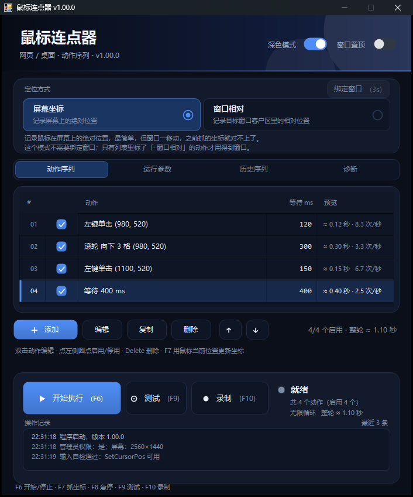

# 鼠标连点器 v1.00.0

Windows 单文件自动点击器，给网页游戏 / 网页应用 / 桌面程序用。
C# WinForms，.NET Framework 4.x，系统自带 `csc.exe` 编译，不依赖 Python / Java / NuGet。

**当前版本：1.00.0**



---

## 1. 快速开始

1. 双击 `AutoClicker.exe`（**建议放在桌面或 `D:\Tools` 这类普通目录**，见第 8 节）。
2. 第一次打开会有一条示例动作「左键单击 (500, 400)」。
3. 把鼠标移到目标位置 → 点中那条动作 → 按 `F7` 更新坐标。
4. 按 `F6` 开始，`F8` 紧急停止。

想先确认这台机器能不能用：进「诊断」页 → 点「输入探针」→ 点「探针自测」。
提示「自测通过」就说明合成鼠标键盘是通的。

---

## 2. 界面

### 定位方式（顶部两张卡，二选一）

卡上直接写了两者的区别，选中哪张，下面那行说明就跟着变：

- **屏幕坐标** —— 记录鼠标在屏幕上的绝对位置。
  最简单，但窗口一移动，之前抓的坐标就对不上了。适合固定不动的界面。
- **窗口相对** —— 记录的是目标窗口客户区里的相对位置，执行时按窗口当前位置换算。
  **窗口拖动、重新打开都还能点准**，适合会挪位置的游戏窗口。

选「窗口相对」时：

1. 下面那行会变成提醒，右上角的「绑定窗口」也会高亮；
2. 点它，然后在 3 秒内切到目标窗口；
3. 绑定成功后，如果列表里正好有落在窗口内的屏幕坐标动作，会问你要不要**一起转成窗口坐标**
   （窗口外的动作不受影响）。

另外：切换方式**不会**改已有动作的坐标 —— 每个动作自己记住自己是哪种坐标，
列表里窗口相对的动作会标「· 窗口相对」；切换只影响之后新加 / 编辑的动作。

### 动作序列

支持四种动作：鼠标点击、鼠标滚轮、键盘按键、等待。

- **启用/停用**：点每行最左边的圆点。禁用行会灰掉，执行时直接跳过、也不等待。
- **常用操作**：
  - 双击动作 = 编辑
  - `Delete` = 删除，`Ctrl+D` = 复制一份
  - `Alt+↑` / `Alt+↓` = 上移 / 下移
  - **右键动作行** = 编辑 / 复制 / 停用 / 上移 / 下移 / 删除
  - `F7` = 用鼠标当前位置更新选中动作的坐标
- 每个动作有独立的「动作后等待」，单位 ms，列表里直接显示「≈ 0.12 秒 · 8.3 次/秒」。
- 右上角随时显示「4/4 个启用 · 整轮 ≈ 0.98 秒」，改参数立刻更新。

### 运行参数

| 参数 | 说明 |
| --- | --- |
| 循环次数 | `0` = 无限循环 |
| 启动延迟 | 开始前等多久，方便你切窗口 |
| 位置抖动 | ±N 像素随机偏移 |
| 时间抖动 | ±N 毫秒随机偏移 |
| 点击按住 | 按下到抬起的时长，默认 40ms |
| 双击间隔 | 双击动作两次点击之间的间隔 |
| 点击方式 | `SendInput`（推荐）/ `mouse_event`（个别老程序只认这个） |
| 点击前先激活目标窗口 | 目标不是前台时先切过去，避免第一下点击被吃掉 |

**两种点击方式到底差在哪**（界面上也写了同样的说明）：

- **SendInput**：Windows 现在的标准输入接口，走系统统一的输入队列，绝大多数程序、浏览器、游戏都认。
  **优先用这个。**
- **mouse_event**：Windows 的老接口（2000 年代那套）。兼容性更"土"，个别老游戏 / 老程序只认它。
  如果 SendInput 点了完全没反应，换成它再试一次；两个都不行基本就是目标程序主动屏蔽了。

> 循环次数**默认 0 = 无限循环**，按 F8 停。

### 历史序列

- 保存当前 / 载入 / 测试 / 执行 / 删除 / 重命名；双击一条序列可以直接载入。
- 保存时**原样保留每个动作的坐标类型**（屏幕 / 窗口相对）。
- 载入含窗口相对动作的序列时会提醒你重新绑定窗口。

### 诊断

- **输入探针**：开一个计数窗口，验证「合成输入到底有没有到达别的窗口」，还会统计右键事件数。
- **日志区**：可以直接用滚轮翻（不用先点一下），右键「复制全部」，`Ctrl+C` 也行。
- **探针自测**：自动移动 + 点击探针，把结果写在下面。
- **权限检查**：本程序是否管理员、当前前台程序是否提权（提权目标是点不动的头号原因）。
- **打开日志**：看 `run.log`，每次点击都有 `MOVE` / `CLICK` 两行。
- **以管理员重启**：一键提权重开。

---

## 3. 快捷键

| 键 | 功能 |
| --- | --- |
| `F6` | 开始 / 停止 |
| `F7` | 用当前鼠标位置更新选中的点击动作；动作弹窗打开时直接捕捉坐标 |
| `F8` | 紧急停止（同时结束录制；只松开真的按下过的键，不会额外产生点击） |
| `F9` | 测试一次（1 轮、0 启动延迟、不抖动） |
| `F10` | 开始 / 停止录制 |
| `Delete` / `Ctrl+D` / `Alt+↑` / `Alt+↓` | 列表里删除 / 复制 / 上移 / 下移 |

热键是全局的，游戏窗口在前台也能用。启动时如果被别的程序占用会在日志里提示。

---

## 4. 录制

- `F10` 立即开始；点「录制」按钮会先倒计时 2 秒，方便切窗口。
- 记录：左/右/中键点击、滚轮、键盘按键 + Ctrl/Alt/Shift 组合键；动作间隔写进前一个动作的等待时间。
- 滚轮按「格」记录（一格 = 系统里的 120）：触摸板那种很小的增量会先攒够一格再记；同一位置 600ms 内的同向滚动会合并成一条，不会把列表刷成几十条。
- 同一位置 350ms 内的两次点击会合并成「双击」。
- 不记录：拖拽、长按、输入法文字；点击本程序窗口、在本程序里打字不会被录进去。
- **只记录、不拦截**：所有钩子回调都会 `CallNextHookEx`，录制中鼠标键盘照常可用。
- 合成/注入的输入（脚本、远程桌面、宏软件发出的）不会被记录，这是刻意的。
- 录制结束把动作**追加**到当前列表末尾。

---

## 5. 数据文件

**都在 exe 同目录的 `数据\` 文件夹里** —— 整个文件夹拷走就能用，换电脑不用重新配：

```
AutoClicker\
├─ AutoClicker.exe
└─ 数据\
   ├─ settings.ini     动作 + 运行参数 + 主题 + 窗口位置，可手工编辑
   ├─ sequences.dat    历史序列库
   ├─ run.log          运行日志，每次启动重写，排查问题就看这个
   └─ crash.log        崩溃记录（正常不会有）
```

> 如果 exe 放在 `C:\Program Files` 这类不可写的目录，会自动退回 `%APPDATA%\AutoClicker3`。
> 实际路径在「诊断」页第一行会写出来。
> 旧版本存在 `%APPDATA%\AutoClicker3` 的配置，第一次用便携目录时会自动搬过来。

`settings.ini` 每行动作格式：

```
C|按钮|双击|X|Y|坐标空间|等待|启用     # 0 左键 1 右键 2 中键；坐标空间 0 屏幕 1 窗口客户区
K|按键码|修饰键|等待|启用
W|等待|启用
```

卸载：删掉 exe 和 `%APPDATA%\AutoClicker3` 就行。

---

## 6. 为什么重做过一次

最早那版（v2）最后的状态是「屏幕坐标能移动但不点击、窗口相对完全不动」，功能越多越不可用。
根因是坐标用「全局模式 + 全局布尔 + 原地改数值」维护，一条路径绕过换算就全乱。

v3 的做法：

| 项目 | v2 旧做法 | v3 做法 |
| --- | --- | --- |
| 坐标空间 | 全局 `_modeIndex`，绑定时偷偷改所有动作的坐标 | **每个动作自己保存 `Screen` / `WindowClient`**，永不隐式换算 |
| 鼠标移动 | `SetCursorPos`，不校验 | `SendInput` 绝对坐标 + `GetCursorPos` 逐次校验，失败自动退回 `SetCursorPos`，仍失败明确报错 |
| 鼠标点击 | `mouse_event` 固定写法 | `SendInput` 按下/抬起分离（可按住 N 毫秒），可切 `mouse_event` 兼容模式 |
| 鼠标滚轮 | 无 | SendInput + MOUSEEVENTF_WHEEL，按「格」滚动，先移动到目标位置再滚 |
| 点击前激活 | 启动时 `SetForegroundWindow` 一次，可能被拒绝且无感知 | 每次点击前检查该点窗口是否前台，不是就 `AttachThreadInput` 强制激活再点 |
| 结束/急停松键 | ——（曾无条件松三个键，导致每轮结束多一次右键） | 只松开**确实按下过、还没抬起**的键 |
| 出错处理 | 异常吞掉 | 全部写日志 + 界面红字；启动先自检本进程能否控制鼠标 |

v3.1 是界面重做：分段式页签、自绘表格与复选框、图标按钮、弹出菜单、记住窗口位置，
顺带把操作逻辑（复制动作、右键菜单、键盘快捷键、整轮耗时估算、空状态提示）补上。

---

## 7. 编译

需要 Windows + .NET Framework 4.x（系统自带，不用装 SDK）。

```bat
build.bat
```

自测（会开两个窗口、真实移动鼠标并点击，结果写 `selftest.log`，退出码 0 = 通过）：

```bat
AutoClicker.exe --selftest
```

---

## 8. 点不动怎么办

按这个顺序排查，基本能定位：

### 8.1 程序所在目录被限制

某些**受安全策略管控的目录**（企业 / 学校电脑的受管目录、部分沙箱或云同步盘挂载点）
会拦截进程合成的鼠标键盘输入：同一个 exe 在这类目录里 `SetCursorPos` 直接返回失败，
复制到桌面或 `C:\Temp` 就完全正常。

表现：程序能开、能跑，日志里 `MOVE` 报失败，但光标一动不动。

**解决：把 exe 放到桌面、`D:\Tools\...` 或其它普通目录再运行。**
如果换了目录还是不行，再看 8.2 / 8.3。

### 8.2 目标程序是管理员权限，本工具不是

Windows 会拦掉普通权限程序发过去的点击/按键（UIPI）。
表现：能移动、日志显示点击已发送，但目标毫无反应。
**解决**：诊断页点「以管理员重启」。

### 8.3 安全软件拦截模拟输入

腾讯电脑管家 / 火绒 / 360 等的「行为防护」「模拟输入拦截」会拦不认识的小工具。
**解决**：把 `AutoClicker.exe` 加进白名单 / 信任列表。

### 8.4 目标程序自己屏蔽合成输入

部分游戏 / 反作弊 / 带 Pointer Lock 的网页会过滤 `SendInput`。
- 诊断页「输入探针」能点动 → 输入通道没问题，是目标程序在过滤。
- 试试把「点击方式」改成 `mouse_event`。
- 都不行就是目标程序主动屏蔽，没有通用解法。

---

## 9. 目录结构

```
autoclicker-v3/
├─ AutoClicker.exe          编译产物（约 155KB，也可从 Releases 下载）
├─ build.bat                一行命令编译
├─ app.manifest             asInvoker / PerMonitorV2 DPI
├─ 快速上手.txt
├─ LICENSE.txt
├─ README.md
├─ 数据/                    运行时生成：配置 / 历史序列 / 日志
├─ screenshots/
│  ├─ dark.png
│  └─ light.png
├─ assets/
│  ├─ app.ico
│  └─ app.png
└─ src/
   ├─ Native.cs             所有 P/Invoke
   ├─ Model.cs              动作模型 / 配置读写 / 序列库 / 日志
   ├─ InputEngine.cs        移动 / 点击 / 按键，带校验与松键跟踪
   ├─ Runner.cs             执行器（深拷贝参数，坐标只在执行时解析）
   ├─ Recorder.cs           录制（低级钩子，只读不拦）
   ├─ Hotkeys.cs            全局热键
   ├─ Theme.cs              配色 + 小图标绘制
   ├─ Controls.cs           自绘控件（卡片/按钮/开关/选择卡/输入框/弹窗/日志视图）
   ├─ Dialogs.cs            动作弹窗 / 命名弹窗
   ├─ ProbeForm.cs          输入探针
   ├─ MainForm.cs           主窗体
   ├─ SelfTest.cs           --selftest
   ├─ Program.cs            入口
   └─ AssemblyInfo.cs```

---

## 10. macOS 版（预览）

`macos/` 目录里有一份 macOS 的移植，**功能是 Windows 版的子集**：
屏幕坐标的点击 + 滚轮 + 等待、循环 / 延迟 / 按住、F6 / F7 / F8 / F9、配置存档。

- 界面是原生 AppKit，跟随系统深色 / 浅色，不是 Windows 版那套自绘风格；
- 键盘按键、录制、历史序列、窗口相对坐标**还没做**（滚轮已支持）；
- **这份代码没有在 Mac 上编译验证过**（这台机器没有 macOS）。编译交给
  GitHub Actions 的 `macos-latest`：推上去之后 Actions 会产出 `AutoClicker-macOS.zip`，
  下载解压即可。第一次跑如果报编译错误，按日志修。

细节看 [`macos/README.md`](macos/README.md)。

---

## 11. 打包成压缩包

目录已经按"能直接压缩"整理好了，整个 `AutoClicker` 文件夹压缩即可：

```
AutoClicker/
├─ AutoClicker.exe        直接双击运行，绿色单文件
├─ 快速上手.txt           30 秒上手
├─ README.md              完整说明（本文件）
├─ LICENSE.txt            MIT
├─ 数据/                  第一次运行自动生成（配置 + 历史序列 + 日志）
└─ screenshots/
   ├─ dark.png
   └─ light.png
```

注意：**解压到普通目录**（桌面、`D:\Tools` 之类）。放在受安全策略管控的目录里，
合成的鼠标/键盘输入可能被拦掉（详见第 8 节）。
